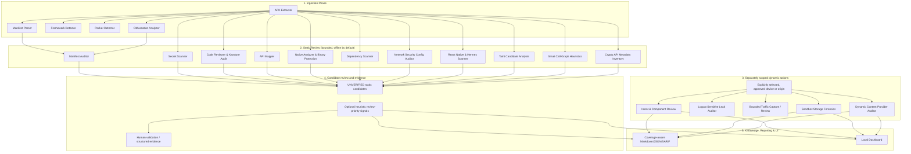

# MobileAg Architecture & Component Map

## Overview
MobileAg is an authorized mobile-app security workbench. Its default APK workflow is offline static analysis; device/API testing uses separate explicitly scoped actions and is not automatically implied by an APK scan. Static analyzers emit review candidates, not exploit confirmations. Optional LLM, reachability, sanitizer, and historical signals only annotate/rank candidates.



---

## Directory Structure

```
Mobile_Ag/
├── config/                  # Configuration & LLM Provider Routing
│   ├── llm_config.py
│   └── settings.py
├── data/                    # CWE, MASVS & Signature Reference Databases
│   ├── cwe_database.json
│   ├── known_packers.json
│   └── masvs_mapping.json
├── mobileag/
│   ├── analysis/            # Security Analysis Modules (SAST)
│   │   ├── api_mapper.py
│   │   ├── binary_protection_auditor.py
│   │   ├── crypto_api_auditor.py
│   │   ├── code_reviewer.py
│   │   ├── dependency_scanner.py
│   │   ├── manifest_auditor.py
│   │   ├── native_analyzer.py
│   │   ├── network_security_config_auditor.py
│   │   ├── react_native_scanner.py
│   │   └── secret_scanner.py
│   ├── core/                # Pipeline Orchestration & State Management
│   │   ├── orchestrator.py
│   │   └── state.py
│   ├── dast/                # Dynamic Application Security Testing (DAST)
│   │   ├── adb_manager.py
│   │   ├── intent_fuzzer.py
│   │   ├── logcat_auditor.py
│   │   ├── provider_auditor.py
│   │   ├── storage_auditor.py
│   │   └── traffic_auditor.py
│   ├── diffing/             # APK Version Differential Analysis
│   │   └── version_diff.py
│   ├── filters/             # Advisory candidate ranking; not exploit verification
│   │   ├── confidence.py
│   │   ├── consensus_vote.py
│   │   ├── historical_match.py
│   │   ├── pipeline.py
│   │   ├── reachability.py
│   │   └── sanitizer_check.py
│   ├── generators/          # Script & Guide Templating Engines
│   │   ├── frida_generator.py
│   │   ├── poc_generator.py
│   │   └── templates/
│   ├── ingestion/           # Extraction & Decompilation Parsers
│   │   ├── apk_extractor.py
│   │   ├── framework_detector.py
│   │   ├── manifest_parser.py
│   │   ├── obfuscation.py
│   │   └── packer_detector.py
│   ├── knowledge/           # Graph & Vector Database Integration
│   │   ├── feedback.py
│   │   ├── neo4j_graph.py
│   │   ├── qdrant_store.py
│   │   └── schemas.py
│   ├── llm/                 # Multi-LLM Provider Adaptors
│   │   ├── consensus.py
│   │   ├── fallback.py
│   │   ├── router.py
│   │   └── providers/
│   ├── reporting/           # Report Compilation & Formatting
│   │   ├── cvss.py
│   │   ├── finding.py
│   │   ├── masvs.py
│   │   └── report_engine.py
│   └── web/                 # Enterprise Web Security Dashboard
│       ├── app.py
│       └── templates/
│           └── index.html
├── tests/                   # Automated Unit & Integration Test Suite
├── docker-compose.yml       # Neo4j & Qdrant Services setup
├── pyproject.toml           # Project Dependencies
└── README.md                # Project Overview & Setup Instructions
```

---

## Phase Breakdown

| Phase | Component | Responsibilities |
|---|---|---|
| **Phase 1** | Ingestion & provenance | Archive validation, APK hash and bounded tool-version capture, APKTool/JADX extraction, manifest/build metadata, framework and obfuscation inventory. APK splits and failed/limited extraction must remain explicit coverage gaps. |
| **Phase 2** | Static review | Bounded analyzers inspect decoded source, resources, manifest, native bytes and bundle/config artifacts. Findings are heuristic candidates; unsupported formats and incomplete parsing are coverage gaps. |
| **Phase 3** | Candidate annotation | Optional reachability/sanitizer/model/history signals annotate and rank candidates; they do not prove or remove findings. Unavailable/skipped stages must be recorded. |
| **Phase 4** | Explicit dynamic actions | ADB/device, API and traffic actions require exact authorization and selection. Root/shell output, instrumentation or a crash is not ordinary-app exploit proof. |
| **Phase 5** | Evidence & reporting | Coverage-aware Markdown/JSON/SARIF, local dashboard, structured analyst evidence, version diff, and optional attack-surface knowledge integrations. Candidate severity labels remain provisional until validated. |
