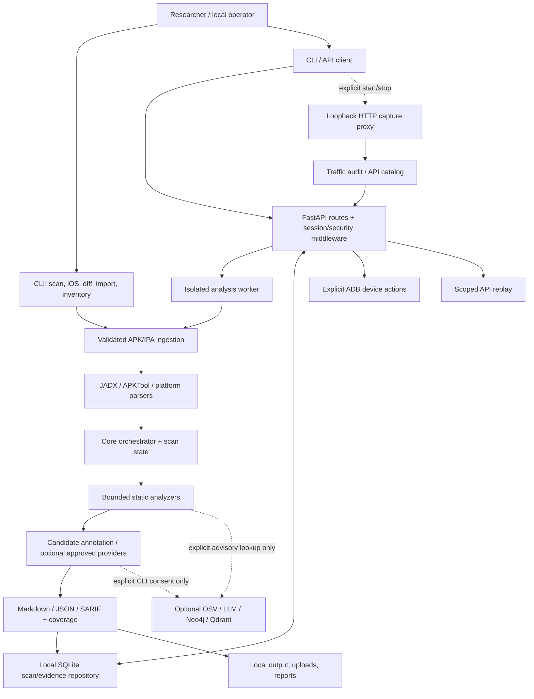
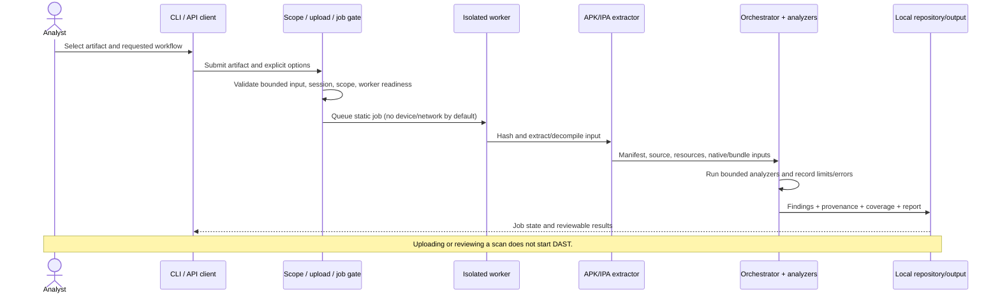

# MobileAg

**A local-first workbench for authorized Android and iOS application security review.**

[](https://github.com/shambhu332/Mobile_Ag/actions/workflows/project-validation.yml)

[Quick start](#quick-start) · [Architecture](#architecture) · [System design](#system-design) · [Security model](#security-model-and-scope) · [API capture](#dynamic-api-discovery-and-capture) · [Testing](#validation-and-tests) · [Contributing](CONTRIBUTING.md)

MobileAg combines bounded offline APK/IPA analysis, evidence-oriented reporting, a local API, and separately authorized device/API workflows. It helps a researcher inventory attack surfaces and prioritize manual review. It is **not** an autonomous exploit verifier, a guarantee of complete analysis, or authorization to test an app/backend.

> **Research boundary:** Test only applications, devices, and backend origins you own or are explicitly authorized to assess. Use researcher-controlled accounts and synthetic data. Static candidates and captured traffic do not prove server-side vulnerabilities. The project is private and has no selected project-level license; dependency licenses do not license this repository.

## What it does

- **Android static review:** APK extraction/decompilation, artifact/build metadata and hashes, manifest/component review, source/resource rules, API route inventory, secret/config candidates, native and cross-platform artifact review, dependency inventory, and bounded source-to-sink heuristics.
- **iOS static review:** IPA/Info.plist, ATS, Mach-O and related static checks through the iOS analyzer.
- **Coverage-aware findings:** Markdown, JSON and SARIF outputs retain candidate status, provenance, static/runtime/proof state, parser/coverage limits, and analyst evidence boundaries.
- **Local API:** Bearer-authenticated scan, reporting, evidence, settings, and scoped workflow endpoints. No web UI is shipped.
- **Explicit dynamic operations:** individually approved ADB/device diagnostics, selected-package observation and scoped API replay. Dynamic actions are separate from a static APK scan and require exact scope.
- **API discovery/capture:** static route literals plus opt-in loopback HTTP capture of researcher-generated traffic; inspect redacted transactions and run offline heuristics against the capture.
- **Optional integrations:** approved CLI-only cloud LLM review, explicit OSV advisory lookup, and optional Neo4j/Qdrant services. Their presence does not establish that a stage ran or that a finding is true.
- **Import/interchange:** bounded, offline projection of external SARIF and a supported MobSF JSON subset as unverified candidates; bounded AAB input inventory; OpenAPI/HAR exports for observed/inventoried API data.

## Contents

- [Architecture](#architecture)
- [System design](#system-design)
- [Quick start](#quick-start)
- [CLI workflows](#cli-workflows)
- [Static Android/iOS analysis](#static-android-and-ios-analysis)
- [Dynamic API discovery and capture](#dynamic-api-discovery-and-capture)
- [Device diagnostics](#device-diagnostics)
- [Evidence, coverage, and interpretation](#evidence-coverage-and-interpretation)
- [Security model and scope](#security-model-and-scope)
- [Configuration and data handling](#configuration-and-data-handling)
- [Validation and tests](#validation-and-tests)
- [Repository map](#repository-map)
- [Known limitations and roadmap](#known-limitations-and-roadmap)
- [Contributing](#contributing)

## Architecture



The diagram shows logical boundaries, not a claim that every optional integration is enabled. Web static analysis is isolated in a worker; the authenticated API does not silently inherit provider credentials or turn an APK upload into a live test. Device/API work is a distinct operator-controlled path.

### Component responsibilities

| Layer | Main code | Responsibility |
|---|---|---|
| CLI and configuration | `mobileag/cli.py`, `config/` | Commands, typed settings, explicit offline/advisory/provider choices. |
| Ingestion | `mobileag/ingestion/` | Validate/extract APK inputs, parse manifests, detect frameworks/packers/obfuscation, retain artifact provenance and bounded inventory. |
| Orchestration | `mobileag/core/` | Coordinate analysis stages, state, coverage, errors and report inputs. A failed stage is not represented as a clean result. |
| Static analysis | `mobileag/analysis/` | Manifest, API, secrets, code, taint, crypto API metadata, native, dependency, network-security, framework and platform checks. Results are bounded review candidates. |
| Candidate annotation | `mobileag/filters/`, `mobileag/llm/` | Optional heuristic prioritization or explicitly approved model review; annotations do not prove exploitability or silently erase candidates. |
| Dynamic testing | `mobileag/dast/`, `mobileag/security/network.py` | Device diagnostics, traffic auditing/capture, route cataloging, explicit replay and selected narrow test helpers. Exact scope is enforced at action/network boundaries. |
| Web application | `mobileag/web/`, `mobileag/dashboard/` | Bearer-authenticated local API, scope policy, isolated jobs, scan/evidence persistence, and reporting. The legacy browser bundles remain removed. A new offline browser workspace is available explicitly with `mobileag web --ui`; API-only startup remains the default. |
| Reporting/evidence | `mobileag/reporting/` | Finding schema, coverage, reports, SARIF interchange/import, structured analyst confirmation and provenance. |
| Optional knowledge | `mobileag/knowledge/` | Neo4j/Qdrant adapters and feedback abstractions. Not required for the standard offline scan. |
| Regression and docs | `tests/`, `docs/` | Synthetic, isolated checks; workflow evidence; schemas and roadmap. Tests do not certify field recall or absence of vulnerabilities. |

For a lower-level architecture inventory, see [`ARCHITECTURE.md`](ARCHITECTURE.md). For market-derived priorities and explicitly unimplemented work, see [`docs/MARKET_ADAPTATION_ROADMAP-2026-10-13.md`](docs/MARKET_ADAPTATION_ROADMAP-2026-10-13.md); that roadmap is not evidence that proposed features exist.

## System design

### Static scan lifecycle



1. **Select an artifact.** The CLI or authenticated API receives an APK/IPA. Upload is staging, not consent to scan or test.
2. **Validate and identify.** Input/archive bounds, artifact identity and tool metadata are recorded. APK splits, unsupported content and extraction failures may limit coverage.
3. **Extract/decompile.** Android uses configured JADX/APKTool tools; parsers are not perfect and obfuscation/native code may reduce visibility. iOS uses the IPA analyzer.
4. **Analyze.** Independent engines inspect bounded inputs. The orchestrator captures per-engine status and errors; it does not convert missing coverage into a pass.
5. **Report and retain.** Findings, coverage, artifact provenance and report metadata are written to the local workspace/repository. Reports are review artifacts, not proof.
6. **Validate manually.** Analysts inspect source/context, reproduce only within authorized scope, and attach structured evidence where justified.

### Dynamic/API lifecycle

Dynamic actions do not follow automatically from a static scan. The operator separately configures exact device/origin/method scope, explicitly selects the target/action, and uses synthetic data. API capture forwards only traffic that the configured client sends through the local proxy; it does not autonomously explore app screens or discover every backend route.

### Data and trust boundaries

- **Untrusted inputs:** APK/IPA archives, imported SARIF/MobSF JSON, source/binary strings, device output, captured HTTP traffic and analyst notes.
- **Trusted control plane:** local operator session, environment ceilings, persisted scope, server-side validation and worker policy.
- **Evidence:** values may be redacted before persistence/export; captures can still contain sensitive metadata, so keep the data directory protected and test only with synthetic accounts.
- **External egress:** disabled for offline scans. Cloud source review is restricted to explicit CLI consent/configuration; web workers do not receive provider keys. OSV lookups are separately explicit. See [configuration and data handling](#configuration-and-data-handling).
- **Scope is conjunctive:** persisted scope can narrow, never enlarge, the server environment allowlists. API replay and capture also validate server-side destination/method constraints; the client is not the security boundary.

## Quick start

### Requirements

- Python 3.11+ (project metadata); use a supported, tested environment from [`requirements/validated-python314.txt`](requirements/validated-python314.txt) for closest CI parity.
- `jadx` and `apktool` installed and available in `PATH` for Android APK extraction/decompilation.
- For web API static jobs: Linux bubblewrap (`bwrap`) and a working ordinary-user systemd manager/user cgroup. Missing isolation fails closed. Use **Settings → Check local readiness**.
- Optional: Android SDK Platform Tools (`adb`) for device workflows; Frida Python/server only for the explicitly approved Frida diagnostic path.

### Install and launch

```bash
python3 -m venv .venv
source .venv/bin/activate
python -m pip install --upgrade pip
python -m pip install -e '.[test]'
[ -f .env ] || cp .env.example .env
MOBILEAG_API_TOKEN="$(python -c 'import secrets; print(secrets.token_urlsafe(32))')" python -m mobileag.cli web --host 127.0.0.1 --port 8080
```

The server exposes an authenticated API only; there is no browser UI. Configure a researcher-managed `MOBILEAG_API_TOKEN` for API clients and keep the service bound to loopback. Requests require a bearer token; the session lifetime and authorization checks remain enforced.

Data is stored under the current working directory by default, or `MOBILEAG_DATA_DIR` when configured. Preserve original artifacts and user data; do not place secrets in test fixtures.

### Install only what you need

```bash
python -m pip install -e '.[frida]'      # optional Frida bindings
```

## CLI workflows

```bash
# Offline Android APK scan, Markdown by default
python -m mobileag.cli scan --apk owned.apk --offline --output ./output

# JSON or SARIF report
python -m mobileag.cli scan --apk owned.apk --offline --format json
python -m mobileag.cli scan --apk owned.apk --offline --format sarif

# iOS static inspection
python -m mobileag.cli ios --ipa owned.ipa --format markdown

# Compare two APK versions
python -m mobileag.cli diff --old old.apk --new new.apk --output ./output/diff

# Bounded source taint candidates
python -m mobileag.cli taint --src ./decompiled/java --output ./output/taint

# Bounded Android App Bundle input inventory only (not analysis)
python -m mobileag.cli inventory-aab --input owned.aab --output aab-inventory.json

# Import external results as a separate untrusted candidate projection
python -m mobileag.cli import-sarif --input external.sarif --output imported-candidates.json
python -m mobileag.cli import-mobsf-json --input mobsf-report.json --output imported-mobsf-candidates.json
```

The `dast` CLI command is deliberately disabled. Use individual approved API actions instead; it will not pick a device, install an app or contact a target. Android scan exit status indicates pipeline completion/error, not whether findings exist. A completed scan can still have partial coverage.

`--offline` prevents LLM/OSV requests. OSV lookups are disabled unless a scan explicitly includes `--lookup-advisories`; that sends supported parsed dependency coordinates and exact versions to OSV. Do not combine `--offline` and `--lookup-advisories`. Lockfile/dependency support is bounded and incomplete; APKs often omit build-time metadata.

## Static Android and iOS analysis

### Android inputs and analyzers

The Android orchestrator can inspect decoded Java/Kotlin and Smali plus selected resources/configuration, manifest, native libraries and framework artifacts. Depending on input/tool support, analysis includes:

- exported components, permissions, intent/deep-link/provider surfaces and manifest flags;
- API endpoints and route-shaped strings (including supported Smali/resource/bundle literals), cleartext/dev URL and sensitive-looking route review leads;
- hardcoded secret/config candidates;
- WebView, PendingIntent, intent redirection and related source/config patterns;
- bounded source-to-sink and Smali local-flow heuristics;
- network security config and transport settings;
- bounded Java/Kotlin literal and exact adjacent Smali constant-register crypto-factory metadata (allowlisted algorithm/mode names, call counts, relative locations only); this is not a key-size or cryptographic-quality assessment;
- native/JNI and binary-protection indicators;
- React Native/Hermes, Flutter and IL2CPP artifact heuristics;
- dependency inventory from supported Gradle/Maven/npm/Yarn metadata.

These are not full Android semantic analysis. Unsupported languages, reflection, generated code, splits, dynamic loading, native flows, obfuscation, incomplete decompilation and analyzer budgets can leave gaps. An endpoint literal is not proof it is used; a route name does not establish authentication/authorization behavior.

### iOS analysis

The iOS analyzer performs static IPA inspection (including Info.plist, ATS and Mach-O-related checks). This is not a full iOS dynamic test or complete Swift/Objective-C call-graph analysis.

### External report imports

- SARIF 2.1.0 is schema-validated offline and projected into bounded candidate data. Producer status/evidence is not trusted; imported results remain unverified, do not alter scan history, and are not MobileAg's own findings.
- MobSF import supports a bounded subset (`code_analysis.findings` and `manifest_analysis.manifest_findings`). Shape/version compatibility is not universal; unsupported structures fail rather than being guessed.
- AAB inventory records bounded module/DEX/native member metadata and artifact SHA-256. It does **not** decode protobuf manifests, generate device split APKs, decompile, or analyze code.

## Dynamic API discovery and capture

### Static route inventory

During APK analysis, the API mapper inventories recognized Retrofit annotations, URL strings and bounded route-shaped literals in selected source/resource formats. Binary/resource hits may be emitted with `method: UNKNOWN` and `evidence_type: route_literal`. They are static leads—not necessarily valid or reachable routes. Runtime status remains `not_tested` unless separate runtime evidence is actually collected.

### Scoped HTTP proxy

The optional authenticated capture proxy listens on loopback `127.0.0.1:8082` and requires `MOBILEAG_PROXY_TOKEN`. It forwards researcher-generated HTTP requests only when the origin and method match the persisted `api_capture` scope and server origin ceiling. It records bounded/redacted transactions for inspection and offline traffic heuristics.

1. Configure server allowlists and proxy token (example below).
2. In API persisted scope, enter exact authorized backend origins, allowed methods, and enable the `api_capture` action. Persisted scope cannot expand the server allowlist.
3. Explicitly start capture through the authenticated `/api/dast/api-capture/start` route.
4. Configure a controlled client to use the loopback proxy and proxy bearer credential; exercise only authorized flows with synthetic accounts/data.
5. Inspect `/api/dast/api-capture/transactions`, run `/api/dast/api-capture/audit`, then stop capture.

The workflow is operator-driven. It does not launch an APK, configure Android proxy settings, perform TLS interception, bypass pinning, fuzz every route or replay traffic automatically. HTTPS `CONNECT` is explicitly unsupported. For HTTPS, use an authorized interception setup and import/inspect captures through the supported workflow. Do not use real customer credentials or data.

### Explicit API replay

The API replay path requires exact server-approved origins and methods. Destination resolution is validated/pinned, TLS verification stays enabled, redirects are not followed, and response size/time are bounded. API replay is an actual network action: inspect the exact URL/method/body and account context before approving it. A successful request or a `200` response alone does not prove an access-control flaw.

## Device diagnostics

Set exact server-side scope before using the API:

```bash
export MOBILEAG_ALLOWED_DEVICES='emulator-5554'
# Only when explicitly authorizing a TCP-connected emulator/device:
export MOBILEAG_ALLOWED_CONNECT='127.0.0.1:5555'
```

Select a specific researcher-controlled device; no first-device/implicit target selection. Read-only observation does not consent, enter credentials or tap through account flows. Device actions require individual scope and current session checks. Root/shell/Frida output is privileged diagnostic evidence and is **not** proof that an ordinary app can achieve the same access. No automated root/SSL bypass is implemented. Frida checks require optional bindings, compatible server and an already running app; script generation or initialization is not an exploit result.

The authenticated API also exposes a bounded read-only device console under `/api/console`: metrics snapshots/streams, PID-attributed and redacted logcat streams, process/package/device/settings inventories, and package-specific shared-storage directory listings. These operations require the exact device in server and persisted scope (`execute_adb`, `logcat`, or package-scoped `storage`). The shell endpoint accepts only a fixed read-only diagnostic command grammar; it is not a general command runner. There is no browser UI for these endpoints. Live logcat is an observation stream, not a finding verdict; events are limited, redacted best-effort and associated with PIDs observed for the selected package. File-content reads are intentionally omitted until remote symlink containment can be guaranteed.

## Evidence, coverage, and interpretation

MobileAg distinguishes:

- **Inventory:** a string, component, API route or configuration item exists in inspected input.
- **Candidate:** a heuristic/static rule identified a pattern for review.
- **Runtime observation:** behavior was observed under a recorded device/build/account/traffic context.
- **Confirmed finding:** an analyst has reproducible evidence of security impact within an authorized threat model.

Most automated results are `UNVERIFIED` candidates. Severity labels are provisional triage values, not impact proof or bounty scores. Taint heuristics are bounded; AST support does not prove reachability. Missing headers, route names, root-shell access, crashes, LLM consensus and absent findings do not prove backend access control or exploitability.

Coverage should be read with every result: static/runtime/proof states, `exhaustive` flag, stage errors, limits and skipped formats. `not_tested`, `not_analyzed`, `incomplete` and `unknown` are not passes. Review exact artifact hash, package/version, OS/device/build and tool versions when reproducing results. Decompilers can omit or transform code; inspect Smali/native/artifact material when appropriate.

Structured analyst evidence binds to scan/artifact identity and requires independent validation; notes or imported data are not automatically verified. Historical comparisons and relocation leads are not proof that a finding was fixed. Reports are schema-stable where documented, but run timestamps/IDs mean outputs are not byte-identical across scans.

## Security model and scope

### Scope requirements

Dynamic scope is explicit and conjunctive:

- `MOBILEAG_ALLOWED_DEVICES`: exact device serials;
- `MOBILEAG_ALLOWED_CONNECT`: exact approved TCP connection hosts/ports, only if needed;
- `MOBILEAG_ALLOWED_ORIGINS`: exact HTTP(S) origins (including non-default port);
- persisted server scope: may narrow server ceilings, including devices/packages/origins/methods/actions;
- explicit operator session and per-action confirmation.

An empty dynamic scope means static-only. Private/local network targets additionally need `MOBILEAG_ALLOW_PRIVATE_TARGETS=1`; do not enable it casually. Never point the tool at unrelated targets, broad CIDRs, third-party services or production customer data without explicit authorization.

### Local deployment assumptions

The API is designed for a loopback, single-user research lab. It is not a multi-tenant security boundary. Keep it bound to `127.0.0.1`, protect the host and data directory, use a strong secret where configured, and do not expose it through a public reverse proxy. Use bearer credentials for API clients; server policy and network gates are authoritative.

### Example environment

Start from `.env.example`; do not commit `.env` or credentials. A minimal offline/local setup may look like:

```dotenv
OFFLINE=true
MOBILEAG_DATA_DIR=/path/to/private/mobileag-data
MOBILEAG_API_TOKEN=replace-with-a-long-random-programmatic-api-secret
MOBILEAG_PROXY_TOKEN=replace-with-a-separate-random-proxy-secret
MOBILEAG_ALLOWED_DEVICES=emulator-5554
MOBILEAG_ALLOWED_ORIGINS=https://api.example.test
MOBILEAG_ALLOW_PRIVATE_TARGETS=false
```

Only set origins/devices after authorization. Proxy capture additionally requires persisted scope with `api_capture`, exact origins and allowed methods. Never reuse app passwords, API keys or bearer tokens as the API/proxy secrets.

## Configuration and data handling

- **Default/offline posture:** configure `OFFLINE=true` for deterministic local analysis. API-triggered workers are offline and do not receive cloud provider keys.
- **LLM providers:** only configure providers/destinations approved for the source being reviewed. CLI cloud review is an explicit egress decision; source snippets may contain secrets or proprietary logic. API optional AI review is separately consented and metadata-only as implemented. LLM content is advisory and not a verifier.
- **OSV:** only explicit `--lookup-advisories` sends parsed supported Maven/npm coordinates and versions. It is not whole dependency resolution.
- **Proxy/replay:** only authorized origins/methods; captured data is redacted but still sensitive. Store reports and captures in a restricted directory and delete them under your retention policy.
- **Optional databases:** Neo4j/Qdrant are not needed for baseline analysis. Configure strong credentials before `docker compose up -d`; compose binds ports to loopback. Historical feedback is not proof of model training/vector synchronization.
- **Retention:** scan history/triage lives in local SQLite; outputs/uploads are local files. Review deletion/purge confirmation carefully. Uploaded original artifacts are preserved by the workflow; don't manually overwrite evidence.

## Validation and tests

Run the unit/regression suite:

```bash
python -m pytest -q
```

Additional bounded checks:

```bash
python scripts/evaluate-sast-benchmark.py
python scripts/evaluate-smali-flow-benchmark.py
python scripts/check-reproducible-wheel.py
```

The two micro-benchmarks cover only their labeled synthetic cases; metrics are not whole-app detection recall. The compiled Android regression uses a synthetic APK; the Genymotion fixture regression requires an explicitly approved test emulator. Old/rooted emulator results validate integration only, not ordinary-app exploitability on a current device.

Passing tests prove only the tested implementation paths and fixtures. Production-device, representative APK corpus, external interoperability, and manual accessibility acceptance are separate validation gates. The latest project validation workflow badge is informative; verify CI run status before making release claims.

## Repository map

```text
Mobile_Ag/
├── config/                 Settings and provider configuration
├── data/                   CWE/MASVS and detection reference data
├── docs/                   Architecture, schemas, reviews, validation, roadmap
├── mobileag/
│   ├── analysis/           Static analyzers and platform/framework scanners
│   ├── assessments/        Guided assessment/test-plan models and services
│   ├── automation/         Explicit workflow/task orchestration
│   ├── core/               Scan orchestration and state
│   ├── dashboard/          API routes and CLI commands
│   ├── dast/               Device, traffic, proxy and runtime modules
│   ├── diffing/            Version comparison
│   ├── filters/            Candidate annotation/ranking signals
│   ├── generators/         Manual guide/script generators
│   ├── ingestion/          Archive extraction, manifest/framework parsing
│   ├── knowledge/          Optional graph/vector integrations
│   ├── llm/                Provider router/adapters and consent controls
│   ├── reporting/          Findings, evidence, coverage and report formats
│   ├── security/           Archive/network/privacy/sandbox helpers
│   └── web/                FastAPI application, policy, templates and assets
├── scripts/                Build, validation and benchmark utilities
├── tests/                  Synthetic unit, integration and boundary regressions
├── ARCHITECTURE.md          Detailed architecture/component map
├── CONTRIBUTING.md          Development and validation guidance
└── pyproject.toml           Package metadata and dependencies
```

## Known limitations and roadmap

- Static discovery is heuristic, bounded and dependent on extraction/parser coverage. No tool can establish completeness from a clean report alone.
- Dynamic testing is not automatic; this README's capture proxy handles HTTP only and does not configure a device or decrypt TLS.
- The legacy all-in-one DAST CLI is disabled. Use individually scoped API actions.
- API fuzz/replay capabilities are deliberately constrained; authenticated cross-account authorization testing still needs explicit, safe setup and human interpretation.
- Web app is single-user/local-first; remote multi-user hosting is unsupported.
- Some security checks are inventory/rule heuristics, not deep semantic analysis. Native/reflection/dynamic code paths and complex frameworks may be missed.
- Cryptographic API inventory is static and bounded; Smali support is limited to exact adjacent constant-register calls. It does not resolve imports/types, native/reflection calls, dynamic algorithms, key sizes, or runtime reachability.
- Provider cost/quota/token usage is not measured. External service features require a separate egress decision.

See the [market adaptation roadmap](docs/MARKET_ADAPTATION_ROADMAP-2026-10-13.md) for prioritized future work and the [contributor roadmap](docs/CONTRIBUTOR_ROADMAP.md) for bounded starter tasks. A roadmap item is not an implemented capability until code and validation evidence exist.

## Contributing

1. Read [`CONTRIBUTING.md`](CONTRIBUTING.md).
2. Choose a bounded task in [`docs/CONTRIBUTOR_ROADMAP.md`](docs/CONTRIBUTOR_ROADMAP.md) or open an issue.
3. Add synthetic regression fixtures; isolate devices, provider credentials and network access.
4. State precisely what you changed, what passed, what was not tested and any coverage limits.

Small documentation, accessibility, evidence-quality and synthetic-test improvements are welcome. Live device or paid AI access is not required for the mocked regression suite. The repository is currently private; collaborators need owner-granted access. No project-level license has been selected.

## Project references

- [Architecture and component map](ARCHITECTURE.md)
- [Contributor guide](CONTRIBUTING.md)
- [Contributor starter roadmap](docs/CONTRIBUTOR_ROADMAP.md)
- [Market-informed implementation roadmap](docs/MARKET_ADAPTATION_ROADMAP-2026-10-13.md)
- [Report schemas](docs/schemas/README.md)
- [Scoped API capture workflow](docs/API_CAPTURE_WORKFLOW.md)
- [Current API matrix](docs/product-security-review-2026-10-05/CURRENT_API_MATRIX.md)

## Optional browser workspace

Launch the new local, Djini-inspired static-review workspace with:

```bash
# Enter a privately configured server token without putting it in shell history.
read -rsp 'MobileAg API token: ' MOBILEAG_API_TOKEN; echo
export MOBILEAG_API_TOKEN
mobileag web --ui --host 127.0.0.1 --port 8080
```

Open the `/ui` URL printed by the server (normally `http://127.0.0.1:8080/ui`) and connect using the same token. The token stays only in the tab's memory. Without `--ui`, the server stays API-only.

The workspace supports archive staging and explicitly approved offline static scans, finding/evidence inspection, coverage/provenance and report downloads. **Advanced tools** adds reviewed forms for the supported API workflows: guided assessments, automation, scoped device/API diagnostics, scope/settings editing, analyst decisions, source/graph investigation and live events. CLI adapters add SARIF/MobSF imports, AAB inventory, uploaded-source taint and two-APK comparison. Uploading never starts a scan. Disconnect clears this tab; it does not revoke the server token or cancel jobs.

See the [workflow coverage matrix and validation boundaries](docs/studio-parity-2026-10-17/README.md). Browser scans stay offline; server setup, provider secrets and CLI cloud/advisory flags remain terminal-managed. Retired unsafe operations stay disabled.

See [architecture review and design](docs/studio-2026-10-17/REVIEW.md) and [screenshots, validation and limitations](docs/studio-2026-10-17/README.md). No demo results or external assets are shipped.
