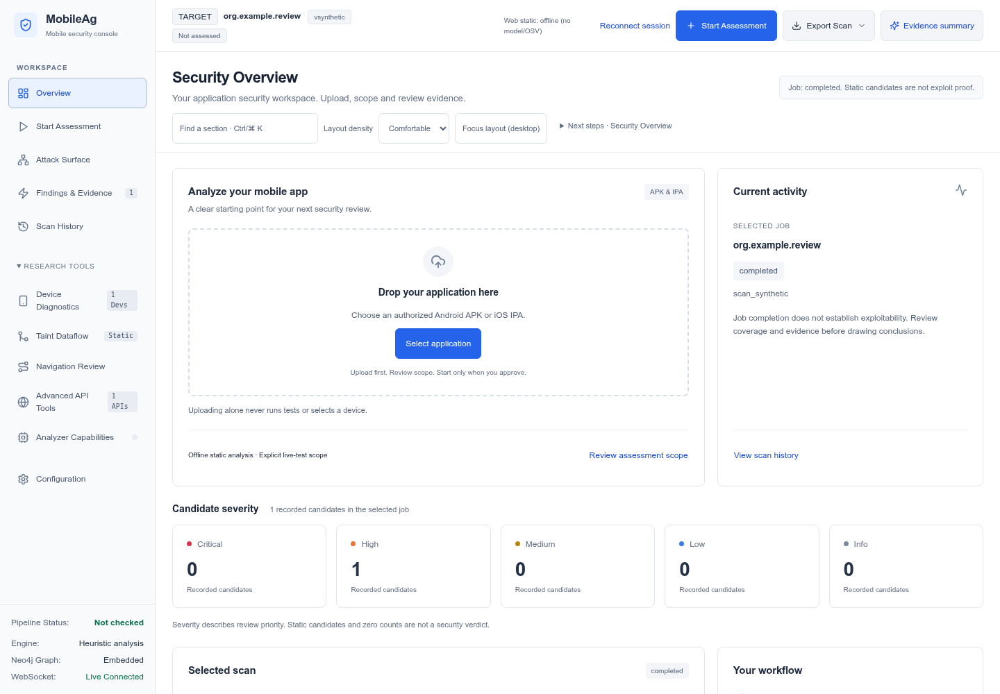

# MobileAg

**A local-first workbench for authorized mobile application security review.**

[](https://github.com/shambhu332/Mobile_Ag/actions/workflows/project-validation.yml)

[Quick start](#quick-start) · [Contribute](CONTRIBUTING.md) · [Starter tasks](docs/CONTRIBUTOR_ROADMAP.md) · [Report a bug](https://github.com/shambhu332/Mobile_Ag/issues/new?template=bug_report.yml) · [Request a feature](https://github.com/shambhu332/Mobile_Ag/issues/new?template=feature_request.yml)

See the [market-informed product implementation roadmap](docs/MARKET_ADAPTATION_ROADMAP-2026-10-13.md) for prioritized MobileAg improvements, acceptance criteria, and explicit non-goals. It is a plan, not a claim that proposed work is already implemented.

Review static candidates, inspect evidence, configure optional AI review, and run explicitly scoped device diagnostics from an authenticated local dashboard.

- Android APK decompilation through JADX/APKTool; iOS IPA static inspection.
- Source, manifest, resource, native-symbol and bounded lexical taint review candidates (including limited same-file method summaries and callback-shaped Intent parameters).
- Markdown, JSON and SARIF reports with explicit unverified finding status.
- Opt-in, scoped ADB diagnostics and bounded Frida initialization checks.
- Authenticated HTTP/WebSocket APIs, bounded uploads, and scope-controlled HTTP replay.
- [Dashboard UI tools and evidence review](docs/dashboard-ui-2026-10-11/README.md), with session controls, guided navigation, HTTP/curl reads and visible evidence/coverage gaps.
- [Dashboard self-connection, section navigation and read-only curl](docs/dashboard-self-navigation-2026-10-11/README.md) with ephemeral tokens and no automatic scan/device actions.

This is research tooling, not an autonomous exploit verifier. Read the limitations below before relying on a report.



*The overview uses real selected-job data; this screenshot uses synthetic fixtures. The Djini-inspired interface retains MobileAg branding and is not affiliated with Djini.*

## Contribute

Recent work adds bounded offline authentication/Firebase review, structured
confirmation evidence and more conservative reports. See the
[validated changes and remaining gaps](docs/workflow-hardening-2026-10-08/README.md)
and [contributor starter tasks](docs/CONTRIBUTOR_ROADMAP.md).

Help improve the workbench through **documentation, accessible UI, synthetic regression fixtures, and evidence-quality improvements**. Small, focused pull requests are welcome; a live device or paid AI account is not required for the mocked regression suite.

1. Read the [contributor guide](CONTRIBUTING.md).
2. Pick a [bounded starter task](docs/CONTRIBUTOR_ROADMAP.md) or discuss an idea in an issue.
3. Include a reproducible synthetic test and an honest description of what was validated.

This repository is currently private: collaborators need access from the owner. No project-level license has been selected yet; bundled dependency licenses do not license the whole project. Public-release and licensing decisions remain with the owner.


## Quick start

```bash
python3 -m venv .venv
source .venv/bin/activate
python -m pip install -e '.[test]'
[ -f .env ] || cp .env.example .env
python -m mobileag.cli web --host 127.0.0.1 --port 8080
```

Python 3.11+ is declared; the release validation snapshot uses Linux Python 3.14.7. Web static scans additionally require bubblewrap and a working ordinary-user systemd manager; use Settings → Check local readiness. Missing isolation fails closed. Open the URL printed by the CLI and paste its session token. A fresh token is generated unless `MOBILEAG_API_TOKEN` is configured. Keep it secret; do not place it in URLs or reports. Data lives under the working directory, or `MOBILEAG_DATA_DIR` when configured.

### Static scans

Install `jadx` and `apktool` in PATH for Android analysis, then upload an authorized APK/IPA or run:

```bash
python -m mobileag.cli scan --apk owned.apk --offline --output ./output
python -m mobileag.cli scan --apk owned.apk --offline --format json
python -m mobileag.cli ios --ipa owned.ipa --format markdown
```

The Android scan command is suitable for a local CI job with exit status `0`
when the scan completes without pipeline errors and nonzero when the scan is
incomplete or fails. Findings do not themselves change the exit status. JSON
reports carry `report_schema_version: 1`; the envelope is described by
[`docs/schemas/mobileag-report-v1.schema.json`](docs/schemas/mobileag-report-v1.schema.json).
Run timestamps and scan IDs are intentionally per-run values, so report files
are schema-stable, not byte-for-byte reproducible across scans.
To verify wheel packaging reproducibility under the installed build toolchain,
run `python scripts/check-reproducible-wheel.py`; it performs two isolated
offline builds with a fixed archive timestamp and compares wheel SHA-256 hashes.
This check does not establish hosted-runner or dependency-supply-chain
reproducibility.

`--offline` prevents LLM/OSV requests. OSV dependency lookups are disabled unless that invocation explicitly includes `--lookup-advisories`; this sends parsed Maven or npm coordinates and exact versions from supported local metadata (including Gradle/Maven metadata and npm `package-lock.json` v1/v2/v3 and Yarn v1 `yarn.lock`) to OSV. This only covers lockfiles present in the analyzed tree; APKs often omit build-time lockfiles, so absence does not mean no dependencies. Unsupported or dynamic lock entries remain unresolved and make inventory coverage partial. The two options cannot be combined. The example environment defaults to offline; explicitly set `OFFLINE=false`, configure provider keys and set `APPROVED_LLM_PROVIDERS='["openai"]'` (or exact approved router names) only if transmitting source for cloud review is permitted. Web static workers are always offline and receive no provider keys. Source/snippet cloud review is supported only through the explicitly approved CLI flow, not by enabling network access in the upload parser. The dashboard has a separately consented aggregate-metadata-only review stage described below. Supported settings persist locally in SQLite and new scans record their actual execution policy. Reports include Markdown, JSON and SARIF. Decompilation errors fail the scan; they do not produce simulated findings.

Offline dependency inventory recognizes literal Maven/Gradle declarations, direct dependencies in DTD-free `pom.xml` files (including bounded whole-value property references declared in that same root POM), `gradle.lockfile`, embedded `pom.properties`, npm `package-lock.json` v1/v2/v3, and Yarn v1 `yarn.lock`. Gradle version-catalog aliases count as dependencies only when a bounded supported dependency declaration references the exact alias; unused catalog entries are not treated as resolved packages. It does not resolve dynamic versions, plugins, providers, dependency graphs, Yarn Berry, or workspace aliases; unresolved declarations and parse failures are counted as partial coverage. Inventory alone is not a vulnerability result. PendingIntent mutability review also resolves only unique bounded Java `final int` or Kotlin `const val Int` flag aliases; helper calls, reassigned variables, ambiguous aliases, and unsupported expressions remain manual-review leads.

Import an external SARIF 2.1.0 file into a separate, untrusted candidate
projection (offline; output must be a new file):

```bash
python -m mobileag.cli import-sarif --input external.sarif --output imported-candidates.json
```

The importer validates the vendored OASIS SARIF 2.1.0 schema offline before
projecting a bounded subset. It enforces size/run/result limits, records the
source SHA-256 and producer provenance, deduplicates rule/location instances,
rejects unsafe file URIs, and discards producer evidence/status. Schema
conformance does not make external claims trustworthy: imported results remain
`UNVERIFIED`; this is not a MobileAg scan report and does not add findings to
scan history. See [`docs/schemas/README.md`](docs/schemas/README.md) for schema
provenance and digest.

For a MobSF Android static JSON report, MobileAg can project a bounded subset
offline:

```bash
python -m mobileag.cli import-mobsf-json --input mobsf-report.json --output imported-mobsf-candidates.json
```

Only `code_analysis.findings` and `manifest_analysis.manifest_findings` are
projected, as `UNVERIFIED` candidates. The CLI applies a 5 MiB input limit,
caps finding counts, redacts output, drops unsafe source locations and never
updates scan history or binds the producer's package assertion to a MobileAg
artifact. MobSF JSON has no importer-enforced producer-version compatibility
matrix here: unsupported shapes are rejected, and a synthetic fixture is not
evidence of compatibility with every MobSF release. The output projection
schema is [`docs/schemas/mobsf-import-v1.schema.json`](docs/schemas/mobsf-import-v1.schema.json).
The recognized field names follow MobSF's current [Android static-analysis
report template](https://github.com/MobSF/Mobile-Security-Framework-MobSF/blob/master/mobsf/templates/static_analysis/android_source_analysis.html),
not a guaranteed stable interchange contract.

For an Android App Bundle, run the separate bounded input-only inventory:

```bash
python -m mobileag.cli inventory-aab --input owned.aab --output aab-inventory.json
```

This records bundle module, DEX-header class-count, and native-library member
inventory with artifact SHA-256. It does not decode protobuf manifests, create
device splits/APKs, decompile or analyze code, or establish delivery/runtime
coverage. See the versioned
[`AAB inventory schema`](docs/schemas/android-app-bundle-inventory-v1.schema.json).

Java Tree-sitter AST support is installed by the default package dependencies
and used by taint review when parsing succeeds. Per-scan coverage records the
available backend and parse fallbacks; Kotlin and unparsed Java still use bounded
lexical heuristics. The AST pass remains bounded/local and does not prove Android
reachability or exploitability.

### Authorized dynamic testing

Set exact device scope before starting the dashboard:

```bash
export MOBILEAG_ALLOWED_DEVICES=emulator-5554
# Only if connecting over TCP:
export MOBILEAG_ALLOWED_CONNECT=127.0.0.1:5555
```

Choose an explicitly authorized device; the dashboard never selects the first device automatically. UI observation is read-only and blocks unrelated packages/system dialogs; it never accepts consent, fills credentials or taps controls. Drag-and-drop stages an artifact for scope review; it does not start testing. CLI dynamic testing uses `--package` (not `--pkg`):

```bash
python -m mobileag.cli dast --serial emulator-5554 --package com.example.owned \
  --no-audit-storage --no-audit-memory
```

The Frida workbench requires `pip install -e '.[frida]'`, a matching server on the selected authorized device, and an already running app. It checks script initialization and detaches. Persistent hook orchestration and automatic root/SSL bypass are not implemented; automatic bypass requests fail explicitly. Root/shell observations do not establish ordinary-app exploitability.

### API replay and capture

Outbound API replay is disabled until exact HTTP(S) origins are configured with `MOBILEAG_ALLOWED_ORIGINS` (comma-separated, include non-default ports). Private/local targets also require `MOBILEAG_ALLOW_PRIVATE_TARGETS=1`. Destination DNS is validated and pinned, TLS is verified, responses are bounded, and redirects are not followed.

The optional capture proxy requires `MOBILEAG_PROXY_TOKEN`, accepts only loopback binding, and uses the same destination scope. It supports bounded HTTP framing through h11. **CONNECT/TLS interception is unsupported** and returns 501 rather than pretending to inspect encrypted traffic.

### Optional databases

Configure strong `NEO4J_PASSWORD` and `QDRANT_API_KEY` before `docker compose up -d`. Database ports bind to loopback only. The main scan pipeline does not perform historical learning; feedback must not be interpreted as vector-store synchronization.

## Evidence and limitations

### Security Overview

The default light dashboard brings together APK/IPA upload, selected-job activity, five candidate-severity cards, scan identity, and next-step navigation. An absent scan shows unknown values rather than an invented clean result. APK upload opens scope review; IPA upload opens the existing advanced static settings. Uploading alone never starts a scan.

See [console implementation and validation](docs/djini-console-2026-10-08/README.md).

### Advanced workspace navigation

Use **Find a section** or **Ctrl/Command K** for keyboard-first workflow navigation across all eleven views, including the new Security Overview. The **Next steps** guide uses the actual selected job and offers navigation only—not execution. Compact density and desktop focus layout are page-local preferences; scan/device/model authorization is unchanged.

Configuration includes searchable local/cloud provider cards, primary/secondary comparison, setup/consent checklists and server-enforced broker limits. Token consumption, cost, quota and tokens/minute are not measured. See [advanced workspace validation](docs/advanced-workspace-2026-10-07/README.md).

### Automatic readiness and approved stage orchestration

**Start Assessment → Automatic readiness checklist** runs after session connection and again before Start: harmless local sandbox probe, trusted worker-tool presence, host-only ADB inventory, saved scope and public provider configuration. It never selects/connects/boots a device, installs tools, starts a test or contacts a model. Missing worker prerequisites or an unavailable/unapproved DAST serial block guided submission. The backend remains authoritative and fails closed independently of the UI.

Explicitly upload, choose exact scope/stages and approve Start once; the existing guided pipeline then runs offline SAST → approved read-only API cases → approved DAST mapping → optional consented metadata-only AI. Navigation input still requires exact action review. Opt in to a single evidence JSON download when those stages finish or pause; loading history never opts in.

Device Diagnostics now distinguishes executable availability, online/approved inventory and **not checked** root/Frida state. After explicit device selection, automatic process observation requires the saved **frida_status** action for that exact dedicated device; it only uses ordinary-shell `ps -A`, never starts Frida, attaches hooks or runs a preset. A process name is not compatibility/attachment proof. Preview is generation-only. Root/TLS bypass, installs, fuzzing and logcat remain separately scoped explicit operations. See [implementation and synthetic validation](docs/auto-ready-2026-10-07/README.md).

### Dashboard LLM configuration

Use **Configuration → LLM provider configuration** to choose the primary provider and an optional distinct secondary, inspect exact server-configured models/setup, and refresh the provider catalog. Selection alone never starts AI review. Choices stay in the current dashboard session; they reset on reload and are not persisted by Save Settings. API keys/models and allowed destinations remain privately server-configured, not editable credentials in the browser.

**Start Assessment → Optional AI review** shows the selected pair and requires explicit primary metadata-egress consent and separate secondary consent. Secondary runs once only after primary HTTP 429; static analysis stays offline. See [configuration UI validation](docs/llm-configuration-2026-10-07/README.md) and [fallback boundaries](docs/provider-fallback-2026-10-06/README.md).

Automated findings are **UNVERIFIED review candidates**, not proven vulnerabilities. Taint detection is a straight-line heuristic, not a complete inter-procedural engine. Symbol presence, exported components, URL paths, shell-readable data and LLM votes do not prove exploitation. Confirmation requires analyst evidence. Dashboard triage is scan-scoped, revision-checked and saved transactionally in local SQLite; legacy original report files are preserved. The legacy unscoped feedback endpoint rejects requests rather than guessing the target scan.

Completed scans support a manual, record-only test plan through authenticated `GET`/`PUT /api/scans/{scan_id}/test-plan`. Plans bind to the scan's package and artifact SHA-256 and use optimistic revisions. They hold role/flow descriptions, test-account aliases (never credentials), coverage states and analyst notes. They do not approve or run device/API actions; notes remain unverified analyst input. A retest plan snapshots its same-package baseline scan ID, artifact SHA-256, and version; `GET /api/scans/{scan_id}/planned-comparison` rechecks that frozen package/hash/version binding before comparing. `GET /api/scans/{current_scan_id}/comparison/{baseline_scan_id}` remains available for explicit read-only exact-location comparisons. A separate `relocation_leads` list can suggest a unique possible file move only when rule/CWE, qualified method identity, and sink operation agree; the exact-location rows remain `not_proof_of_fix`/new, and the lead is never a match or fix verdict. Neither route infers that a missing candidate is fixed. Run the isolated Chromium workflow check with `python tests/browser_test_plan_comparison.py` (or pass its `--chromium` option); it uses only synthetic loopback scan records and runs in the Project validation CI browser job.

The current behavior supersedes the historical capability descriptions above and older architecture/session notes. See [fix status and validation](docs/audit-2026-10-05/FIX_STATUS.md) and the [original review](docs/audit-2026-10-05/REVIEW.md). The subsequent product review and its fixes are tracked in [current product-fix status](docs/product-security-review-2026-10-05/FIX_STATUS.md).

## Tests

```bash
python -m pytest -q
```

Tests isolate real device operations and provider credentials. Use synthetic data and controlled loopback targets when adding regressions. See [CONTRIBUTING.md](CONTRIBUTING.md) for the CI-aligned environment, browser commands, and PR checklist.

The first versioned source-to-sink smoke corpus can be evaluated with
`python scripts/evaluate-sast-benchmark.py`. It reports per-case TP/FP/FN and
precision/recall for the bounded `TaintEngine` only. It includes small
interprocedural return/parameter-flow cases and callback-shaped Intent sources,
but does not resolve overloads, fields, callback overrides, manifest reachability,
full Android lifecycle/ICC, or native flows. Its metrics are **not**
whole-app or product recall. Extend the labeled corpus before claiming improved
coverage.

The separate synthetic Smali local-register smoke corpus is evaluated with
`python scripts/evaluate-smali-flow-benchmark.py`. It covers only modeled
same-method `move-result*` / `move-object` flows and overwrite negatives; it is
not evidence of whole-program DEX/Smali recall or exploitability.

### Browser regression (optional)

Install Playwright in a separate test environment and use an installed Chromium executable:

```bash
python tests/browser_product_regression.py --server-python /path/to/project/venv/bin/python --chromium /path/to/chromium
```

This starts and cleans up an isolated loopback server with synthetic source/findings, mocked device/database integration and no cloud model calls. All runtime assets load locally; the page's real CSP is not bypassed.

## Current transformation and release boundaries

See [current transformation status and requirement matrix](docs/product-security-review-2026-10-05/TRANSFORMATION_STATUS.md), [current API inventory](docs/product-security-review-2026-10-05/CURRENT_API_MATRIX.md), and [validation evidence](docs/product-security-review-2026-10-05/transformation-validation/README.md). Historical audit observations are retained, not silently rewritten as current findings.

- Connect using the labelled session form. Tokens stay in memory; sessions expire after eight hours. Settings provides rotation/logout and explicit reconnect.
- Settings → Authorized scope can only narrow server device/origin ceilings; empty scope means static-only. Root/shell/install/Frida approval is device-wide, not package confinement. Device and live replay operations require explicit scope and synthetic accounts/data.
- Static jobs use a read-only input, offline bubblewrap namespace and a user-systemd resource cgroup. No automatic device actions or cloud parser egress. Default web output location is fixed.
- History supports pagination, cancellation, explicit retry of unchanged originals, and preview/confirm deletion of inactive scan output/metadata/decisions. Uploaded originals are preserved. Interrupted jobs are not automatically replayed after restart.
- Use one loopback API worker and one local operator. Remote/multiuser hosting is unsupported; hiding controls does not provide authorization.
- UI CSS/vendor assets are packaged locally. Rebuild with `npm ci --prefix assets --ignore-scripts && python scripts/build-dashboard-assets.py`; check with `python scripts/verify-dashboard-assets.py`.
- Tested Python versions are pinned in `requirements/validated-python314.txt` as environment constraints, not a fully hashed cross-platform lock or a guarantee against future advisories.
- Actual process regression: `PYTHONPATH=. python tests/sandbox_process_regression.py --output /tmp/mobileag-process-evidence` using the project environment. Only generated ZIP/header fixtures and an owned user cgroup are exercised; no real device/cloud target.

Production/device, representative-corpus and manual assistive-technology acceptance gates remain explicitly open. Automated tests do not certify an entire codebase free of vulnerabilities.

### Optional acceptance checks (not ordinary-app exploit proof)

```bash
PYTHONPATH=. python tests/compiled_android_regression.py --output /tmp/mobileag-acceptance
# Only after explicitly approving this device; refuses existing fixture package:
PYTHONPATH=. python tests/genymotion_fixture_regression.py --serial EXACT_SERIAL --output /tmp/mobileag-acceptance
```

The first command builds a permission-free synthetic binary-manifest/DEX APK
using a trusted APKTool JAR and exercises actual isolated JADX/APKTool parsing.
It requires the same namespace/cgroup support as web scanning. The second signs
that fixture with a temporary key, installs/launches only its unique package,
records Android build/current shell identity, and uninstalls its own fixture.
It does not root, invoke `su`, clear logs or inspect unrelated applications.
Old/rooted emulator results validate integration only. Current unrooted-device,
representative production-corpus and human accessibility acceptance remain
separate gates.

Dashboard code is split into ordered local scripts by workflow: session/actions,
workspace, findings, history/settings, copilot, uploads/exports, telemetry, device,
taint and API. These are classic-script modules with shared workspace state,
not separate tenant/security boundaries; change their template order only with
browser regression coverage.
