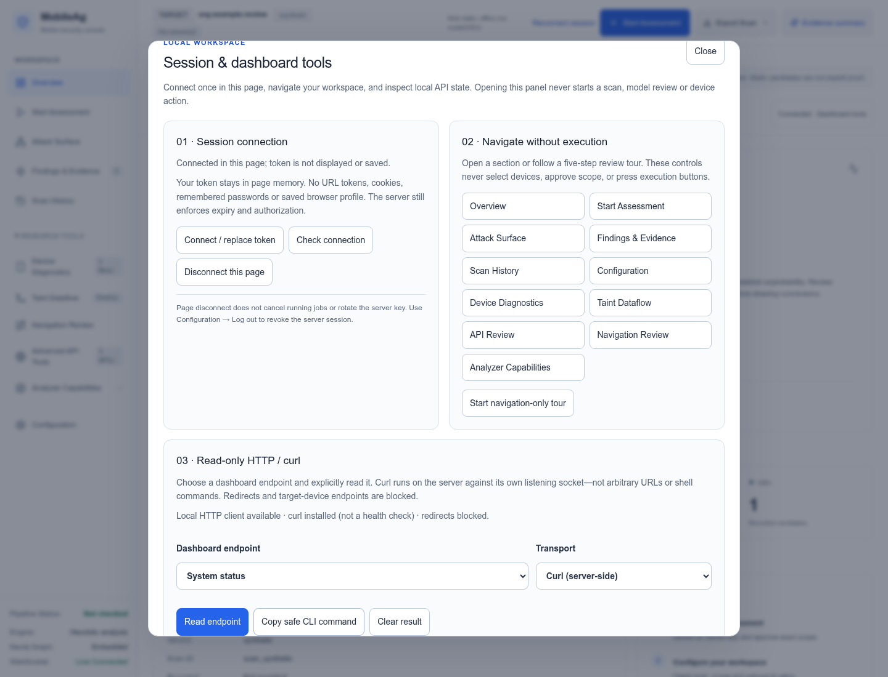

# Dashboard tools UI and evidence review

The existing light MobileAg workspace and target-authorization flow are preserved.
A global **Connected / Disconnected · Dashboard tools** button now opens a shared
responsive panel from every section.

## What changed

1. **Session:** real connection status, explicit connection check, replace-token
   flow and local page disconnect. Tokens are never displayed/saved. Disconnect
   clears workbench results and prevents late responses from reappearing; it does
   not cancel already issued work or revoke the server key. Existing Configuration
   → Log out remains the server-wide revocation control.
2. **Self-navigation:** direct links to all 11 sections and an explicit five-step
   navigation-only review tour, with Previous / Next / Stop and keyboard focus.
   Navigation does not select devices, approve scope or start assessments.
3. **HTTP/curl:** select a fixed dashboard endpoint and transport, then explicitly
   Read endpoint. Loading/busy, availability, bounded result, clear-result and
   token-free CLI-copy states are visible. Curl executes server-side, through the
   existing non-shell client, against the trusted listening socket—not the client
   Host header or an operator-supplied URL. Requests are authenticated and checked
   again after completion. At most two self-read workers per process are retained
   until they finish; child requests remain bounded even after caller cancellation.
4. **Finding review:** visible evidence basis, artifact binding, missing fields,
   downgrade explanation, advisory next step, and structured static trace when
   available. Analyst attestations remain distinct from independent exploit proof.
5. **Assessment review:** a readable coverage ledger, per-stage execution versus
   authentication/authorization coverage, and remaining gaps. Older records show
   unknown coverage, never a clean/security verdict.
6. **Paired-account imports:** a separate operator-approved synthetic JSON import
   form on completed assessments with protected approved API captures. It requires
   an explicit consent checkbox, binds artifact/capture from the assessment, clears
   input after submission and reports imported comparisons as UNVERIFIED. There is
   no login, replay, inferred identity/ownership, or automatic confirmation here.

The panel is keyboard-accessible, has live status/busy feedback, 44px controls,
responsive grids, scrollable results and reduced-motion support. It uses local
CSS/JS assets only. No new browser credential persistence, root/SSL bypass or
implicit device selection was introduced. No unrestricted AI clicking or generic
terminal execution was added.

## Scope and limits

The workbench accepts only allowlisted dashboard GET paths. Device shell/logcat,
Frida, target URLs, generic curl flags, settings writes and arbitrary commands are
not supported. Authentication, server scope and the existing explicit target
approval controls remain independent. Curl installation is a configuration check,
not a health check; reverse-proxy/TLS-offload bindings may not support self-reads
and fail closed. HTTP/curl responses are bounded to 1 MiB; UI paired imports are
bounded to 64 KiB of JSON and the server also bounds each response body.

## Validation

See `validation/results.json` and synthetic screenshots. Tests use a loopback
fixture server, synthetic accounts/data and mocked device/provider adapters.
They do not establish real-app exploitability or actual Android login.

- End-to-end UI: HTTP and actual curl self-reads; desktop/mobile automated axe
  checks; tour navigation; token-free CLI copying; page disconnect/reconnection;
  ignored stale response; text-only malicious evidence rendering; rejected paired
  import clears its raw input; no additional jobs started.
- Follow-up on 2026-10-12: **642 full-suite tests passed**; 30,379 warnings remain.
- Existing product and full-console regressions and all-section self-navigation passed.
- Built-wheel smoke outside the checkout passed: MobileAg 0.1.0, 22 scripts and
  6 stylesheets shipped, unauthenticated API access denied.
- Unit controls reject forged Host selection, off-origin/device/write paths,
  unknown fields, missing authentication and responses completed after rotation.
- Native JS syntax, Python compilation, local assets and whitespace checks pass.



## Reproduce

```bash
python -m pytest -q
python scripts/verify-dashboard-assets.py
python tests/browser_dashboard_tools_ui.py --chromium /path/to/chrome \
  --axe assets/node_modules/axe-core/axe.min.js --output /tmp/dashboard-ui-results
python tests/browser_console_regression.py --chromium /path/to/chrome
python tests/browser_dashboard_navigation.py --chromium /path/to/chrome
```

Review locations: `mobileag/dashboard/routes.py`, `dashboard-tools.js`,
`dashboard-tools.css`, the scan/triage presentation contract, and finding/assessment
render hooks. The new UI browser regression is included in CI.
