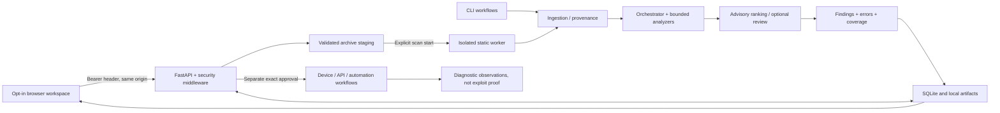

# MobileAg architecture review and browser workspace design

Date: 2026-10-17 · Base commit: `c7d90dd3b5ba469cdc1941f101f32424fd8cc5a5` · Application: `0.1.0`

## Scope and evidence boundary

This is a source-based architecture/workflow review and implementation of a new local UI. It is **not** a claim of exhaustive line-by-line security auditing or a certification of analyzer accuracy. No target APK, device, production account, or external API was tested. Existing uncommitted edits, deleted legacy UI bundles, reports and tests were preserved. No commit, push, deployment, or memory update was performed.

`source-inventory.json` inventories all 155 Python files under `mobileag/` and `config/` after adding the studio module: 35,708 lines at inventory time. It includes file hashes, module summaries and top-level symbol locations. All inventoried files parsed successfully. The initial test inventory contained 74 files and 21,330 lines; new UI tests are additional. Generated `build/`, `dist/`, caches, uploads, output artifacts, credentials and dependency trees are not application-source review coverage.

Review depth:
- **Repository-wide inventory:** Python module structure, imports/symbols, package configuration, architecture and usage documentation.
- **Deeper code tracing:** CLI/server startup, middleware, upload/run/read/export endpoints, isolated jobs, orchestration, source bounds, assessment and automation guards, evidence normalization, coverage calculation, and repository persistence.
- **Representative analyzer review:** Java/Kotlin taint, Android surface/call-graph boundaries, FileProvider XML, framework/native metadata, iOS bundle parsing, and runtime provider/logcat attribution. Other analyzer modules were inventoried; they have not all received a new rule-by-rule correctness audit in this UI task.
- **Controlled validation:** automated unit/integration regressions and a real Chromium browser against an isolated temporary local server with synthetic records. Browser scan execution is intercepted, not actually performed.

## 1. What the project actually is

MobileAg is an offline-first mobile security research pipeline with a local operator API. It is not an autonomous exploit-verification service. Its strongest architectural property is the separation between **candidate discovery**, **bounded execution**, and **analyst-supplied evidence**.

### Component map and UI implications

| Area | Files / observed responsibility | Design consequence |
| --- | --- | --- |
| Entry points | `mobileag/cli.py`: `web`, scan, inventory/import/diff commands; `web/app.py:run_server` | Keep CLI and API-only mode working; browser is explicit `--ui`. |
| Security boundary | `web/security.py:SecurityMiddleware`, `origin_allowed`, `authorized`, `check_device` | Same-origin requests; memory-only bearer; never put credentials in query strings. Public shell is not public data. |
| Archive ingestion | `security/archives.py`, `ingestion/apk_extractor.py:APKExtractor` | Upload is staging, not execution. Match 128 MiB server bound; keep artifact SHA-256 visible. |
| Worker isolation | `web/jobs.py:sandbox_command`, `resource_command`, `isolated_analysis` | Readiness must distinguish unavailable sandbox/tooling from a clean scan. No unsafe fallback. |
| Orchestration | `core/orchestrator.py:Orchestrator`, `core/state.py` | Display measured stage state and gaps; do not show fictional agent activity. |
| Static analyzers | 39 files / 14,494 lines in `analysis/` | Group by researcher workflow instead of a separate navigation item for every analyzer. |
| Source bounds | `analysis/bounded_sources.py:SourceInventory` | Limits, skipped files, and unknown/incomplete coverage must remain inspectable. |
| Dataflow | `analysis/java_ast_taint.py`, `taint_engine.py`, `call_graph.py` | Candidate paths are not runtime reachability or whole-program proof. Source snippets render as text. |
| Platform/framework analysis | iOS analyzer, Flutter/Hermes/IL2CPP/JNI probes | Avoid representing all platforms/frameworks as equally deep or dynamically validated. |
| Ranking | `filters/pipeline.py:FilterPipeline`, `llm/` | Do not turn heuristic scores, provider agreement, or model output into “confirmed.” |
| Guided assessments | `assessments/models.py:Assessment`, `service.py:create`, `guard`, `run` | Future live wizard must collect exact scope, dedicated accounts/device, egress and stage consent. |
| Automation | `automation/engine.py:AutomationService`, `automation/models.py` | Mapping is not action approval; the UI must not create a one-click “exploit everything” control. |
| Device diagnostics | 24 files / 5,020 lines in `dast/` | Shell/root/instrumented observations need explicit context, not ordinary-app impact labels. |
| API boundaries | `security/network.py:scoped_request`, `web/policy.py:check_replay` | Discovered endpoints are not authorized targets. Scope view is read-only in this release. |
| Evidence | `reporting/evidence_contract.py:prepare_finding`, `prepare_scan`; `validation.py:bind_confirmation` | Show server-normalized evidence state; analyst attestation is not independent verification. |
| Coverage | `reporting/coverage.py:review_surface_ledger`, `guided_coverage` | Never equate zero findings, unselected checks, or incomplete jobs with “secure.” |
| Persistence | `web/repository.py:ScanRepository` | Repository is authoritative; do not invent client-side triage or replace scan revisions. |
| Outputs | reporting/export/import modules; source, SARIF, SBOM, OpenAPI routes | Initial browser exposes evidence inspection and SARIF; additional formats remain available through API/CLI. |
| Knowledge | Neo4j/Qdrant adapters | Optional connectivity is not required for the normal static workflow; no graph health calls on page load. |

## 2. Traced workflows

### Artifact → candidate review

1. `POST /api/upload/apk` validates the filename/type/quota, creates an opaque file exclusively with private permissions, bounds the stream, checks the archive and returns the staged path/platform.
2. The UI records that staging result only in memory. It does not infer package identity or launch a scan.
3. The user explicitly checks authorization and presses **Start static assessment**.
4. `POST /api/scans/run` receives the uploaded path and explicit false values for DAST/root/TLS bypass. No output path, device or external destination is selected by the UI.
5. The backend validates the uploaded-root constraint and archive again, hashes it, reserves a job, persists the running record and dispatches its worker.
6. Namespace/resource limits and bounded result handling live in `web/jobs.py`. Worker failure remains a failure, not a security pass.
7. `GET /api/scans/{id}` returns `prepare_scan` output. Findings are rendered with artifact binding, source context, limitations and remediation. Refresh is manual and labeled; this initial release does not claim continuous telemetry.

### Finding → evidence interpretation

`Finding` accepts detector output; `prepare_scan` binds presentation to authoritative scan hash/package/version; `prepare_finding` validates an active structured attestation before showing the analyst-attested basis. Required reproduction fields, controls and unmodified authorization are defined by `ConfirmationEvidence`. This validates record structure, not the truth of an exploit. The new UI neither changes verdicts nor provides an unguarded “Confirm” button.

### Live assessment boundary (reviewed, not exposed for execution)

`AssessmentService.create` checks session, immutable upload identity, package membership, exact policy, selected device/component, account/device confirmations and provider consent. The service reserves a run after awaited validation, persists policy and calls `guard` during later stages. After static work, package mismatch or an incomplete result stops live stages. `AutomationService` keeps discovered actions separate from approved execution. These contracts are more demanding than the static upload form; they are intentionally not approximated by unchecked browser toggles.

## 3. Review observations and follow-up priorities

These are architecture/UX observations, **not newly demonstrated exploitable vulnerabilities**.

1. **The pre-existing UI removal was intentional and broad.** At task start 110 tracked files differed from HEAD, mostly legacy UI/test/document removals. Restoring that bundle would have overwritten the user's direction. The new `mobileag/studio/` is additive, with no restoration of `web/templates`, `web/static`, or `workbench`.
2. **API presentation is a large concentration of responsibility.** `web/app.py` is about 2,400 lines with artifact, scan, source, exports, feedback, diagnostics, capture and orchestration endpoints. Future route extraction should preserve session binding, policy checks and tests, rather than merely moving functions.
3. **Coverage schemas vary.** Some analyzers expose nested status/count/limit records; a generic green completion badge would overstate consistency. The initial UI displays recorded top-level status plus expandable original coverage. A future normalized read-only view can use `review_surface_ledger`, preserving missing mappings explicitly.
4. **Artifact display names lose some context.** `trigger_scan` initializes `app_name` from the opaque uploaded file stem. It may later be replaced by extraction output, but early jobs can look like identifiers. A follow-up backend change could persist a separately sanitized original display filename without using it as a filesystem path.
5. **List statistics are not global findings analytics.** The summary endpoint is paginated. The UI explicitly labels loaded-record counts and provides Load more; it does not fabricate all-history severity totals or independently verified counts.
6. **Deep analysis is bounded.** Java AST/local-flow, lexical Kotlin, Smali may-flow, framework strings and native metadata have different coverage limits. “AI verified,” universal call-graph coverage, successful exploitation and bounty severity cannot be inferred from these modules.
7. **Live diagnostics carry privilege context.** Provider commands are shell diagnostics; logcat attribution uses package/PID/threadtime guards. A browser should not erase those prerequisites behind a “vulnerable” chip.
8. **The dependency environment had drifted.** The system Python baseline failed collection due to missing `packageurl`. Declared test dependencies were added only in a temporary system-site-packages venv, not globally or in this project. The broader suite then ran successfully; see validation notes for exact results.
9. **Prototype approval is not backend authorization.** The static consent checkbox is an interaction safeguard; API clients can still call the existing static endpoint using their bearer. Dynamic enforcement remains on the server. Disconnect clears this tab but does not rotate the server token or cancel running jobs.

## 4. Design direction

Reference: public [Djini.ai homepage](https://djini.ai/), opened and visually inspected on 2026-10-17. Its dark background, purple/blue accents, mobile-security framing and prominent starting action informed the direction. No authenticated Djini product workspace was accessed; this is **inspired by the public site, not an exact clone**, and does not reuse its logos or images.

### Visual system

- Near-black canvas with a quiet, fixed desktop sidebar; restrained lavender primary action and active navigation.
- Clear hierarchy: workspace context → primary task → recorded metrics → recent work → workflow explanation.
- Original lightweight phone/surface illustration built in CSS. No stock photograph, generated bitmap, external font, CDN script or chart dependency.
- Typography uses local system fonts; UI text, badges and status labels provide meaning without relying on color alone.
- Native controls/dialogs, explicit labels, skip link, keyboard focus, modal Escape behavior and reduced-motion handling.
- Narrow screens use stacked navigation, a visible session control, two-column metrics and keyboard-focusable horizontally scrollable tables. Tiny screens do not crush application names to one character per line.

### Information architecture

| Screen | Primary question | Implemented interactions |
| --- | --- | --- |
| Overview | Where do I begin / resume? | Connect, new assessment, recent record navigation, loaded-record summary. |
| Assessments | Which artifact/run needs attention? | Text/status filtering, pagination, open record, refresh. |
| Findings | What was observed and what remains unproven? | Per-scan selection, severity/text filtering, evidence inspector, source context, remediation. |
| Coverage & evidence | What ran, what failed, what is unknown? | Hash/version/provenance, recorded progress, nested coverage/errors, SARIF download. |
| Scope & boundaries | What has the operator authorized? | Read-only policy and environment ceiling visibility. No implicit target selection. |
| System | What is configured / can the worker run? | Read-only version/status/configuration, explicit harmless worker-readiness probe. |

### New assessment flow

`Connect → choose authorized archive → stage/validate → review static-only boundary → explicit consent → submit → inspect coverage/findings`

Empty, disconnected, no-match, invalid-file, loading, failed-request, expired-session and incomplete-evidence states are implemented. No seeded demo data is shipped. Synthetic records exist solely in the standalone regression server and screenshots.

### Deliberate initial-release limits

The browser does not yet implement the full guided DAST/API wizard, policy editing, provider configuration/egress consent, confirmation-evidence submission, source-tree browsing, version comparisons, automation approval, capture/replay controls, cancellation/retry, graph visualizations, other report formats, or WebSocket telemetry. Their backend APIs/CLI workflows remain in place. The new interface is a tested core static-review workspace, not a claim that all backend features have complete UI coverage.

## 5. Integration/security design

- `mobileag web` stays API-only. `mobileag web --ui` enables `/ui` explicitly.
- Only four exact GET/HEAD paths are public: `/ui`, `/ui/`, `/ui/app.js`, `/ui/style.css`. They contain no user data/token. No directory mount, wildcard filesystem handler, upload exemption, API exemption, or legacy static route was introduced.
- Host/origin checks and response headers apply to those assets. Existing API bearer and deadline checks remain active.
- Browser fetches use same-origin relative paths, explicit Authorization, `credentials: omit`, no-store and redirect rejection.
- Secrets are kept in a JavaScript closure and removed from the input after connection. No cookie/localStorage/sessionStorage/query-string token.
- Server strings become text nodes, not HTML. Findings can contain markup without executing it.
- Requests have bounded waits; disconnect aborts in-flight requests, increments session/selection generations and clears rendered data. Outdated responses cannot repopulate an old session. This is not server-side token revocation.
- Reports use authenticated fetch plus a temporary Blob download; no bearer is embedded in a download link.
- No device enumeration, graph connection test, readiness probe, scan start, or model call is triggered by simply opening the shell.

## 6. Next steps

1. Add the guided workflow as a separate advanced path only with the full existing approval contract; do not overload the simple static form.
2. Normalize coverage presentation server-side with a conservative ledger; retain original nested evidence.
3. Add scan-scoped source browsing and structured confirmation as focused investigation screens, with optimistic revision checks.
4. Add explicit cancel/retry and scan-scoped telemetry, including session rotation/revocation and reconnect tests.
5. Continue analyzer correctness work using independent location-matched corpora. UI quality and passing tests do not establish APK-wide recall.
